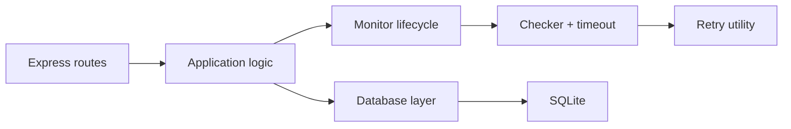

# API Reliability & Incident Monitoring Service

A lightweight self-hosted service for monitoring API health, recording check results in SQLite, and surfacing a small REST API for service lifecycle and health checks. This project is intentionally scoped to a clear engineering foundation: TypeScript, Express, SQLite, structured logging, validation, Dockerized deployment, and testable runtime boundaries.

## Problem it addresses

Small engineering teams often need visibility into whether critical APIs are healthy without bringing up a large SaaS or a microservice platform. This service provides a narrow, self-hosted monitoring foundation for:

- discovering whether a service is currently reachable
- recording response time and failure patterns
- storing service configuration and health history
- exposing a simple REST API for operational inspection
- running in a single container with SQLite and minimal operational complexity

## Public status page

`GET /status/:slug` is the page customers read. The same document is available as JSON (`/status/:slug.json`), an SVG badge (`/status/:slug/badge.svg`), and an Atom feed (`/status/:slug/feed.xml`). The page is server-rendered HTML with its CSS in the response, so it does not depend on a font or stylesheet host.

Visual rules live in `docs/DESIGN.md`. The brief is `docs/DESIGN_BRIEF.md`. Implementation notes are in `docs/DESIGN_IMPLEMENTATION_REPORT.md`.

## Architecture



The project keeps the boundary intentionally simple:

- HTTP routes validate input and manage service registration
- the database layer owns SQLite schema, inserts, and reads
- the monitor defines lifecycle behavior for scheduled checks
- the checker performs a single HTTP probe with timeout
- the retry utility handles generic exponential backoff without knowing HTTP semantics

## Tech stack

- TypeScript
- Node.js 18+
- Express
- SQLite via better-sqlite3
- Zod for validation
- Pino for structured JSON logs
- Vitest + Supertest for automated tests
- Docker and Docker Compose for local deployment

## Project structure

```text
api-monitor/
├── src/
│   ├── app.ts
│   ├── config.ts
│   ├── server.ts
│   ├── db/
│   │   ├── database.ts
│   │   └── migrations.ts
│   ├── routes/
│   │   ├── health.ts
│   │   └── services.ts
│   ├── services/
│   │   ├── alert.ts
│   │   ├── checker.ts
│   │   └── monitor.ts
│   ├── types/
│   │   └── index.ts
│   └── utils/
│       ├── errors.ts
│       ├── logger.ts
│       └── retry.ts
├── tests/
│   ├── api.test.ts
│   ├── checker.test.ts
│   ├── config.test.ts
│   ├── database.test.ts
│   └── retry.test.ts
├── data/
├── .dockerignore
├── .env.example
├── .gitignore
├── Dockerfile
├── docker-compose.yml
├── package.json
├── tsconfig.json
├── vitest.config.ts
├── README.md
└── .
```

## Local development

1. Install dependencies:

   ```bash
   npm install
   ```

2. Copy the example environment and adjust it if needed:

   ```bash
   cp .env.example .env
   ```

3. Start the dev server:

   ```bash
   npm run dev
   ```

4. The service listens on the configured port, defaulting to 3000.

## Running tests

```bash	npm test
```

## Building the TypeScript app

```bash
npm run build
```

## Running with Docker

```bash
docker compose up --build
```

This starts the service and mounts the local data directory so the SQLite file persists across container restarts.

## API endpoints

### GET /health

Returns service liveness and database connectivity.

Example response:

```json
{
  "status": "healthy",
  "database": "connected",
  "monitor": "running",
  "activeServices": 0
}
```

### POST /services

Create a monitored service.

Request:

```json
{
  "name": "Payments API",
  "url": "https://example.com/health",
  "intervalSeconds": 30,
  "timeoutMs": 5000,
  "failureThreshold": 3
}
```

### GET /services

List all active services.

### GET /services/:id

Fetch a single service by id.

### DELETE /services/:id

Deactivate a service and return 204.

### GET /services/:id/incidents

List incidents associated with the service.

### GET /services/:id/metrics

Placeholder metrics response for the next implementation phase.

## Example API calls

```bash
curl -X POST http://localhost:3000/services \
  -H 'Content-Type: application/json' \
  -d '{
    "name": "Payments API",
    "url": "https://example.com/health",
    "intervalSeconds": 30,
    "timeoutMs": 5000,
    "failureThreshold": 3
  }'

curl http://localhost:3000/services
curl http://localhost:3000/health
```

## Current implementation status

This phase establishes the engineering foundation and includes:

- TypeScript project setup and config validation
- Express API with health and service endpoints
- SQLite database initialization and migrations
- typed domain model and basic application errors
- structured JSON logging with pino
- retry helper with exponential backoff
- checker skeleton using fetch and AbortController
- monitor lifecycle abstraction
- alert sink interface and logging sink
- graceful shutdown wiring
- Docker and Docker Compose configuration
- automated tests for config, database, API, retry, and checker behavior

## Known limitations

This is intentionally not the full incident-detection product described in the design document. The following items are deferred:

- sustained outage detection logic and incident state machine
- scheduler-driven periodic monitoring and rescheduling
- rich metrics computations and time windows
- alert integrations beyond the logging sink
- background worker orchestration beyond the in-memory lifecycle

## Future improvements

The next logical implementation tasks are:

1. Build the scheduler so each service gets a self-rescheduling timeout loop
2. Add the check-and-retry pipeline from monitor to checker to persistence
3. Implement incident opening and resolution rules based on failed checks
4. Extend the metrics API with time-window calculations
5. Add more integration tests around health-check persistence and incident transitions

## Recommended next step

The single most logical next task is to implement the monitor scheduler and the end-to-end check pipeline: service registration -> timed probe -> retry -> health check persistence -> fail threshold evaluation.

This keeps the project grounded in the architecture already established here while preserving a clean path to the full monitoring feature set.

}
```
Returns `503` with `"status": "unhealthy"` if the DB ping fails or the scheduler has crashed. This is what a container orchestrator (or `docker-compose` healthcheck) would poll.

### 5.8 Error format

Consistent JSON error envelope for all non-2xx responses:
```json
{ "error": { "code": "NOT_FOUND", "message": "Service b1e3 does not exist" } }
```

---

## 6. Core Component Design

### 6.1 `checker.ts` — single probe execution

Responsibility: given a URL and timeout, perform **one** HTTP GET and return a normalized result. Knows nothing about retries, services, or the database.

```ts
interface CheckResult {
  ok: boolean;
  httpStatus?: number;
  responseTimeMs: number;
  error?: string; // "timeout" | "network_error" | undefined
}

async function performCheck(url: string, timeoutMs: number): Promise<CheckResult>
```

Implementation notes:
- Uses `AbortController` to enforce `timeoutMs` — this is the mechanism that prevents one hung API from blocking the worker (per the "timeouts" production requirement).
- Treats HTTP 2xx as `ok: true`; 3xx follows redirects by default (or configurable); 4xx/5xx as `ok: false` but still records `httpStatus`.
- Distinguishes a *reached-but-unhealthy* service (got a 500) from an *unreachable* service (DNS failure, connection refused, timeout) — both matter for incident `reason`.

### 6.2 `retry.ts` — retry wrapper

Responsibility: generic exponential-backoff retry, decoupled from HTTP specifics so it's independently unit-testable.

```ts
interface RetryOptions {
  retries: number;       // e.g. 2 (→ up to 3 total attempts)
  baseDelayMs: number;   // e.g. 1000
  factor: number;        // e.g. 2 → 1s, 2s, 4s...
}

async function withRetry<T>(fn: () => Promise<T>, isRetryable: (r: T) => boolean, opts: RetryOptions): Promise<T>
```

Used as:
```
attempt 1 (fails) → wait 1s → attempt 2 (fails) → wait 2s → attempt 3 (fails)
→ final result reported as DOWN
```
This matches the flow diagram in the brief: request fails → retry after 1s → fails → retry after 2s → fails → mark unhealthy. The **final, post-retry** result is what gets written to `HealthCheck` — intermediate retry attempts are not persisted as separate rows (kept as debug-level log lines instead), so uptime math isn't skewed by transient retries.

### 6.3 `monitor.ts` — scheduler & orchestration

Responsibility: own the mapping of `serviceId → interval timer`, call `checker` (wrapped in `retry`), persist the result, and feed it into incident detection.

Key behaviors:
- `start(service)`: registers a `setInterval` (or a self-rescheduling `setTimeout`, preferred — see below) for the service, and fires an immediate first check.
- `stop(serviceId)`: clears the timer; called on delete/deactivate.
- **Self-rescheduling `setTimeout` instead of `setInterval`** is preferred: schedule the *next* check only after the current one (including retries) finishes. This prevents overlapping checks from piling up if a service is slow to respond, which a naive `setInterval` would allow.
- On each result: write a `HealthCheck` row, then call `evaluateIncident(service, result)`.

### 6.4 Incident detection logic

State machine per service, driven by consecutive failure/success counts (kept in memory, reconstructible from the last N `HealthCheck` rows on startup):

```
UP  --(failure)-->  UP (count=1)
UP(count=1) --(failure)--> UP(count=2)
UP(count=2) --(failure, count reaches threshold)--> DOWN, create Incident{startedAt, reason}
DOWN --(failure)--> DOWN (incident stays open)
DOWN --(success)--> UP, close open Incident{resolvedAt, durationSeconds}
```

Notes:
- The threshold is per-service (`failure_threshold`, default 3) rather than global, since a flaky low-priority service and a critical payment API may warrant different sensitivity.
- Recovery is single-success-triggers-close in v1 (simple, matches the brief's diagram). A future enhancement is a symmetric "N consecutive successes to resolve" to avoid flapping — noted in §10.
- On process restart, the in-memory failure-count state is rebuilt by reading each active service's most recent `HealthCheck` rows and any already-open `Incident` row, so a restart doesn't lose incident continuity.

### 6.5 `alert.ts`

v1 ships this as an interface with a single console/log implementation, so the seam exists without committing to a specific provider:

```ts
interface AlertSink {
  notify(event: { service: Service; incident: Incident; kind: 'opened' | 'resolved' }): Promise<void>;
}
```
A `LoggingAlertSink` is the default. This is where a Slack/webhook/email sink would plug in later without touching `monitor.ts`.

### 6.6 `logger.ts` — structured logging

All logs are JSON objects, not strings, e.g.:
```json
{ "level": "error", "service": "payment-api", "statusCode": 503, "responseTimeMs": 812, "timestamp": "2026-08-13T14:03:21Z" }
```
Log levels: `debug` (individual retry attempts), `info` (check completed, service registered), `warn` (approaching failure threshold), `error` (incident opened), plus request logs for the HTTP layer.

---

## 7. Key Design Decisions & Trade-offs

### 7.1 Immediate first check on registration
When a service is registered, run a check right away instead of waiting a full `intervalSeconds`. Better UX (`GET /services` shows real data immediately) at negligible cost.

### 7.2 Self-scheduling timers vs. a cron-style poller
A single external "tick every N seconds, check everything due" loop is an alternative that scales better if this ever needs to run across many processes, but self-rescheduling per-service timers are simpler to reason about and sufficient at the scale implied by "a small company's several APIs." Documented as a known scaling limit (§9).

### 7.3 Simple ratio uptime vs. duration-weighted uptime
`UP checks / total checks` is easy to compute but is biased by check interval consistency. A more correct measure integrates *time* spent DOWN vs UP using incident start/end timestamps. v1 uses the simple ratio for `/metrics` and documents the limitation; duration-weighted uptime is a natural v1.1 improvement since the `Incident` table already has the data needed.

### 7.4 SQLite vs Postgres
SQLite removes an external dependency, which matters for a `docker compose up`-and-go demo and for keeping the interview conversation focused on the app's own logic. The `database.ts` module is written against a small internal interface (`getService`, `insertHealthCheck`, `openIncident`, ...) so swapping the backing store doesn't touch business logic elsewhere.

### 7.5 Retry budget vs. check interval
Retries must complete well within the check interval, or checks start backing up. With `retries=2, baseDelayMs=1000, factor=2`, worst case is ~1s + 2s = 3s of backoff plus request time — safe for the default 30–60s interval, but this constraint (`total retry time < interval`) is validated at service-creation time and documented, not just assumed.

---

## 8. Reliability & Operational Concerns

| Concern | Approach |
|---|---|
| **Retries** | Exponential backoff, capped attempts, implemented in `retry.ts` and unit tested in isolation |
| **Timeouts** | `AbortController`-based per-request timeout in `checker.ts`; a hung upstream API cannot hang the monitor |
| **Health endpoint** | `GET /health` checks DB connectivity and scheduler liveness, returns 200/503 accordingly |
| **Structured logging** | JSON logs via `pino`; every log line carries `service`, `timestamp`, and relevant status fields |
| **Graceful shutdown** | `SIGTERM`/`SIGINT` handlers: stop accepting new HTTP connections, clear all scheduler timers, let in-flight checks finish (bounded by their own timeout), close the DB handle, then exit |
| **Config** | All tunables (`PORT`, `DB_PATH`, default interval/timeout/threshold, retry settings) via environment variables, validated at boot with `zod`; documented in `.env.example` |
| **Containerization** | `Dockerfile` (multi-stage: build TS → slim runtime image) + `docker-compose.yml` exposing the API port and mounting a volume for the SQLite file |

---

## 9. Known Limitations (v1)

- Single-process scheduler: doesn't horizontally scale past what one Node process can poll on schedule; fine for "a handful of APIs," not for hundreds.
- No auth on the API — anyone who can reach the port can register/delete services. Acceptable for an internal tool behind a private network in v1; see §10.
- Uptime metric is check-ratio based, not duration-weighted (see §7.3).
- Incident recovery triggers on a single success, which can flap on marginal services.
- No historical data retention/rollup policy — `HealthCheck` grows unbounded; fine for a demo, needs a pruning or downsampling job for long-term production use.

---

## 10. Future Extensions

- **Auth**: API key or JWT-based auth on write endpoints
- **Alert sinks**: Slack webhook, email (via `AlertSink` interface already defined)
- **Duration-weighted uptime** using `Incident` intervals
- **Flap-resistant recovery**: require N consecutive successes to close an incident, mirroring the failure threshold
- **Data retention**: scheduled downsampling of old `HealthCheck` rows into hourly/daily rollups
- **Multi-node scheduling**: move scheduling into a lightweight job queue (e.g. BullMQ/Redis) so multiple worker instances can share the check load
- **Web3 variant**: as noted in the brief, an alternative track replaces `checker.ts`'s HTTP probe with blockchain RPC polling (watching a wallet address for transactions) — same architecture (scheduler → probe → persistence → REST API), different domain logic. Worth mentioning in an interview as evidence the architecture generalizes.

---

## 11. Testing Strategy

| Layer | What's tested | Tooling |
|---|---|---|
| `checker.test.ts` | Successful check, HTTP 500 response, timeout via a slow mock server, network error (bad host) | `vitest`/`jest` + a local mock HTTP server (`msw` or `http.createServer`) |
| `retry.test.ts` | Retries the correct number of times, backoff timing (using fake timers), stops retrying on success, exhausts retries and surfaces final failure | fake timers to avoid real sleeps in CI |
| `monitor.test.ts` | Incident opens at threshold, stays open on continued failure, closes on recovery, per-service thresholds respected, state correctly rebuilt from DB on "restart" | in-memory/temp SQLite DB per test |
| `services.test.ts` (route/integration) | `POST /services` validation (missing name, bad URL), `GET /services` shape, `DELETE` behavior, `404` handling | `supertest` against the Express app |
| Integration | Full flow: register a service pointed at a mock server, force it to fail 3x, assert an incident appears via `GET /services/:id/incidents`, force recovery, assert it's resolved | `vitest`/`jest` + `supertest` + mock server |

CI should run `npm test` on every push; the Dockerfile build should also be validated in CI to catch container-specific breakage early.

---

## 12. Project Structure (reference)

```
api-monitor/
├── src/
│   ├── server.ts          # Express app bootstrap, graceful shutdown wiring
│   ├── config.ts          # zod-validated env config
│   ├── routes/
│   │   ├── services.ts    # /services CRUD + /:id/incidents + /:id/metrics
│   │   └── health.ts      # /health
│   ├── services/
│   │   ├── monitor.ts     # scheduler + incident state machine
│   │   ├── checker.ts     # single HTTP probe
│   │   └── alert.ts       # AlertSink interface + logging implementation
│   ├── db/
│   │   ├── database.ts    # connection + typed query functions
│   │   └── migrations.ts  # schema creation/versioning
│   └── utils/
│       ├── logger.ts      # structured JSON logger
│       └── retry.ts       # generic retry-with-backoff
├── tests/
│   ├── checker.test.ts
│   ├── monitor.test.ts
│   └── services.test.ts
├── Dockerfile
├── docker-compose.yml
├── package.json
├── tsconfig.json
├── README.md
└── .env.example
```

---

## 13. Open Questions

1. Should `DELETE /services/:id` default to soft-delete (keep history, hide from active list) or hard-delete? Current proposal: soft by default, `?hard=true` opt-in.
2. Is a single-success recovery acceptable for v1, or should flap-resistance be pulled forward from "future extensions"?
3. Any requirement to check services concurrently in batches vs. fully independent timers — matters once the service count grows past a few dozen.